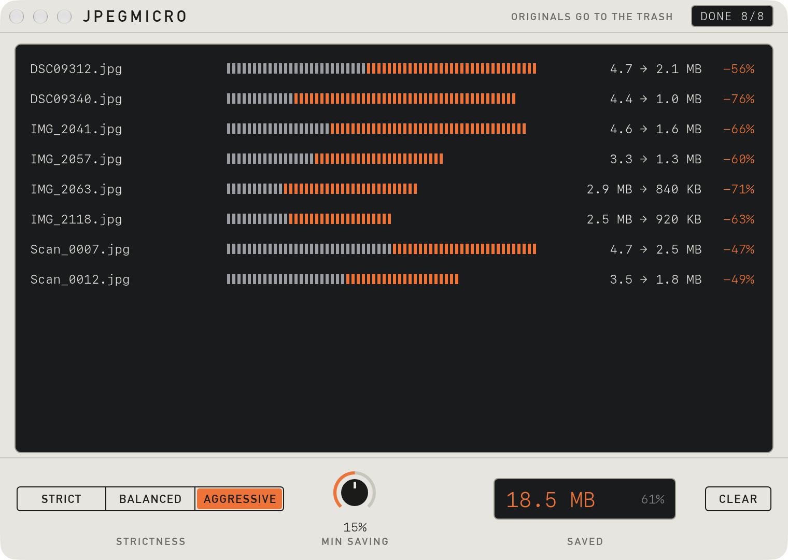

# JPEGmicro



JPEGmicro is a small macOS app that makes JPEGs smaller without making them look different. Drop photos or folders on the window. Each photo is re-encoded with MozJPEG at the lowest quality that DSSIM, a perceptual image metric, still scores as visually identical to the original.

> **Warning: JPEGmicro overwrites your files.** The smaller file replaces the original in place, and the original goes to the Trash. Keep a backup of any photos you care about before you run it, and check the results before you empty the Trash.

## Install

Requirements:

- Apple Silicon Mac (M1 or later). There is no Intel build.
- macOS 13 Ventura or later.

Steps:

1. Download `JPEGmicro-<version>-arm64.zip` from [GitHub Releases](https://github.com/pfinette/jpegmicro/releases).
2. Unzip it and move `JPEGmicro.app` to `/Applications`.
3. Open it once as described below.

The app is not signed with an Apple Developer ID or notarized, so macOS blocks it the first time. On macOS 15 Sequoia and later, right-click → Open no longer bypasses this. Use one of these instead:

- **System Settings.** Open the app once and dismiss the warning. Go to System Settings → Privacy & Security, scroll to the Security section, and click **Open Anyway** next to JPEGmicro. Confirm with your password.
- **Terminal.** Remove the quarantine flag that macOS added when you downloaded the zip:

  ```sh
  xattr -dr com.apple.quarantine /Applications/JPEGmicro.app
  ```

Either step is needed only once. Building from source avoids it entirely.

## What it keeps

- EXIF (capture date, GPS, camera, orientation), XMP, IPTC and the ICC color profile
- Chroma subsampling of the original (4:2:0, 4:2:2, 4:4:4) and its JFIF pixel density
- Permissions, extended attributes (Finder tags) and the created and modified dates

## Rules

- Files JPEGmicro already processed carry a `JPEGmicro v1` comment marker and are skipped.
- A file is replaced only if the result is at least the minimum saving smaller (default 5%).
- CMYK JPEGs and multi-picture JPEGs (HDR gain maps) are skipped. HEIC, PNG and other formats are ignored.
- Hidden files and symlinks are ignored. Folders are searched recursively.
- The new file is written beside the original, verified, and only then swapped in. If anything fails, the original stays untouched.

## Strictness

| Setting | Max DSSIM | Use |
|---|---|---|
| Strict | 0.0005 | Archival; smallest savings |
| Balanced | 0.0010 | Smaller savings; safe middle ground |
| Aggressive | 0.0020 | Default. Biggest savings; still hard to tell apart at 100% zoom |

Quality is searched between 40 and 95.

## Command line

The app bundle includes a CLI that runs the same pipeline:

```sh
/Applications/JPEGmicro.app/Contents/MacOS/jpegmicro-cli --dry-run ~/Pictures/some-folder
```

| Option | Effect |
|---|---|
| `--strict`, `--balanced`, `--aggressive` | Strictness (default: aggressive) |
| `--min-saving <percent>` | Replace only if at least this much smaller (default: 5) |
| `--dry-run` | Report savings without touching files |
| `-h`, `--help` | Show help |

Without `--dry-run`, the CLI replaces files and moves originals to the Trash, like the app.

## Build from source

Needs Rust (`rustup`) and the Xcode command-line tools (`xcode-select --install`).

```sh
git clone https://github.com/pfinette/jpegmicro.git
cd jpegmicro
./bundle.sh            # builds target/JPEGmicro.app
./bundle.sh --install  # also copies it to /Applications/Werkzeuge
```

The first build compiles MozJPEG from C source and takes a few minutes. `bundle.sh` signs the app ad hoc, which is enough to run a copy you built yourself.

## Layout

| Path | Contents |
|---|---|
| `src/lib.rs` | Pipeline: decode, quality search, metadata copy, safe swap |
| `src/main.rs` | egui app |
| `src/bin/cli.rs` | CLI |
| `bundle.sh` | Builds and signs the .app |
| `assets/icon.png` | App icon source |
| `about.toml`, `about.hbs` | `cargo about` config that generates `THIRD_PARTY_LICENSES` |

## License

JPEGmicro's own source code is under the [MIT License](LICENSE). It is provided AS IS, without warranty of any kind. The author accepts no liability for any damage or data loss from using it.

### Notice for binaries

Release binaries link [dssim-core](https://github.com/kornelski/dssim), which is licensed under the GNU Affero General Public License v3.0. The distributed `JPEGmicro.app` as a whole is therefore licensed under AGPL-3.0. Its complete source code is this repository.

Release binaries also include MozJPEG. This software is based in part on the work of the Independent JPEG Group.

[THIRD_PARTY_LICENSES](THIRD_PARTY_LICENSES) lists every bundled dependency with its full license text. A copy ships inside the app at `JPEGmicro.app/Contents/Resources/`. To regenerate it after changing dependencies:

```sh
cargo install cargo-about --locked --features cli
cargo about generate about.hbs -o THIRD_PARTY_LICENSES
```
